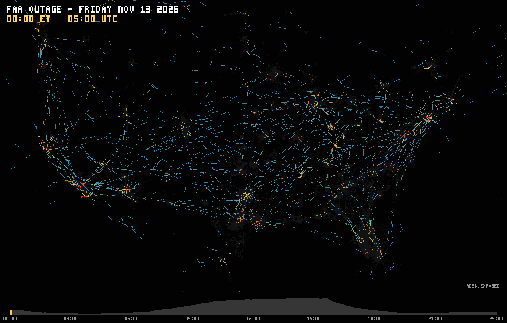
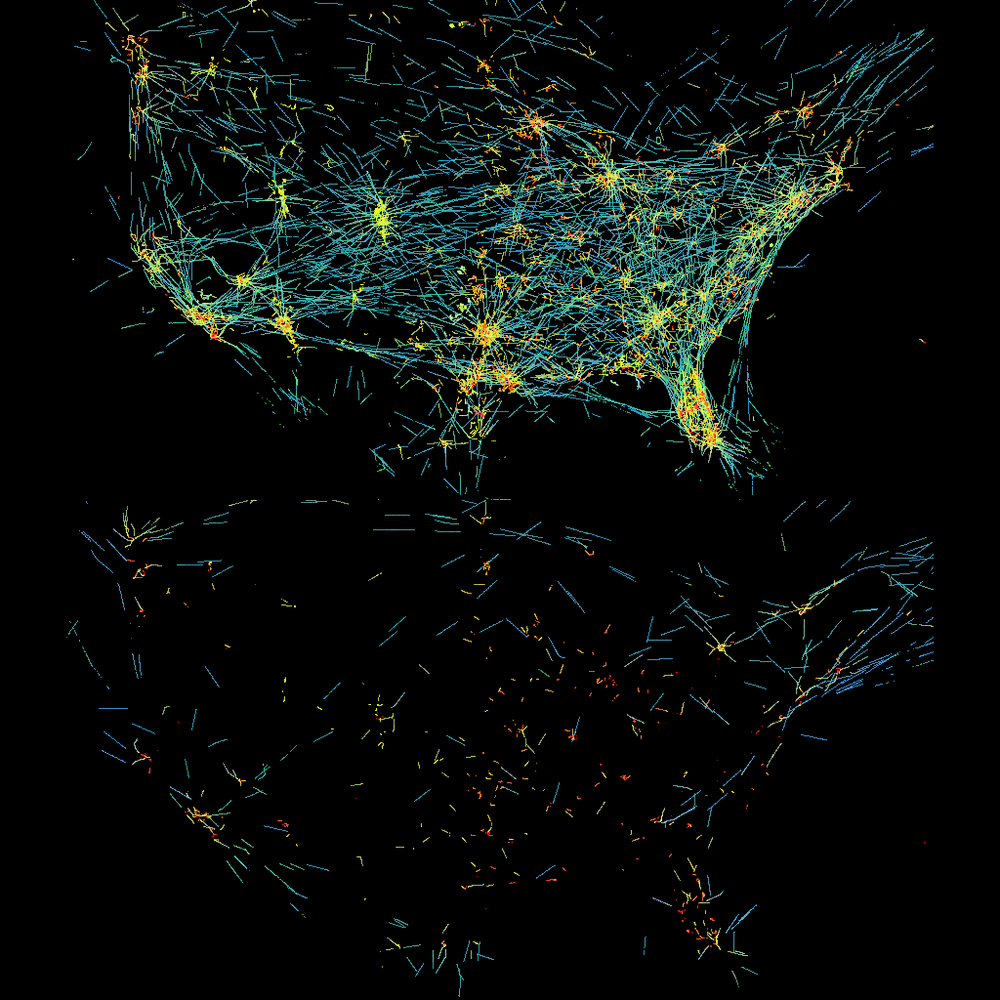

# The Day the Sky Emptied: Rendering the FAA Outage with ClickHouse `FORMAT PNG`

On Friday, November 13, 2026, an FAA outage grounded air traffic across the United States. This post shows the whole day over the lower 48 states, one frame per five minutes, from the ADS-B data on [adsb.exposed](https://adsb.exposed/).



The animation is rendered by ClickHouse itself. There is no plotting library and no image-processing script. A SQL query returns one row per pixel, and the built-in `PNG` output format turns those rows into an animated PNG. The map, the title, the clock and the timeline at the bottom are all rows of the same result set. Even the letters are SQL: a 3×5 bitmap font stored in a `map` literal.

The same animation is also available as a [GIF](faa-outage-2026-11-13.gif) and an [MP4](faa-outage-2026-11-13.mp4).

## What the data shows

In the animation, each aircraft appears as a short streak: the distance it covered in five minutes. The colors follow the default palette of adsb.exposed:
- Red fades with altitude.
- Green grows over the first 5,000 feet, so climbs and descents around airports look yellow and orange.
- Blue shows ground speed, so the cruising traffic at high altitude is blue.

The morning looks like any Friday. The network fills in from the East Coast westwards, and by 13:00–14:00 ET almost 15,000 aircraft are in the air over the frame in any given hour. At around 15:40 ET the number of positions starts to fall, and it keeps falling for the rest of the afternoon. The high-altitude streaks thin out first, and the airports go dark one after another. By 20:00 ET, only scattered low-altitude flights and a few overflights at the edges of the frame are left.

Hourly numbers for the frame (unique aircraft by ICAO address, and those seen above 18,000 ft):

| Hour (ET) | Positions | Aircraft | Above FL180 |
|----------:|----------:|---------:|------------:|
| 12:00     | 4,038,963 | 14,787   | 5,850       |
| 13:00     | 4,151,849 | 14,885   | 6,046       |
| 14:00     | 4,217,014 | 14,957   | 5,995       |
| 15:00     | 3,991,427 | 13,958   | 5,376       |
| 16:00     | 2,556,066 | 10,080   | 3,196       |
| 17:00     | 1,465,549 | 6,304    | 1,658       |
| 18:00     | 949,405   | 4,084    | 907         |
| 19:00     | 543,053   | 2,592    | 632         |
| 20:00     | 418,486   | 2,131    | 559         |
| 21:00     | 566,155   | 2,641    | 1,059       |
| 22:00     | 819,072   | 3,132    | 1,731       |
| 23:00     | 796,677   | 3,128    | 1,929       |

At 20:00 ET, the number of aircraft at cruising altitude is less than a tenth of the early-afternoon level. For comparison, the quietest hour of the previous night (03:00 ET) still had 818. After 21:00 ET the high-altitude traffic starts to come back.

Here is a still image of two 10-minute windows, 14:00 ET (top) and 20:00 ET (bottom). It was rendered by a single query on the public adsb.exposed server (see below):



You can explore the same days interactively: [adsb.exposed, Nov 11–16](https://adsb.exposed/?dataset=Planes&zoom=5&lat=39.9091&lng=-100.9484&query=f3fa6f78cbef2ffb60baafae766e333a&tfrom=2026-11-11&tto=2026-11-16).

## The data

adsb.exposed stores every position report from adsb.lol, airplanes.live and ADSB Exchange in a ClickHouse table, `planes_mercator`. It has 380 billion rows, and each one has the time, the coordinates, the altitude, the speed and the aircraft. The coordinates are also stored in the Web Mercator projection, precomputed as two `UInt32` columns:

```sql
mercator_x UInt32 MATERIALIZED 4294967295 * ((lon + 180) / 360),
mercator_y UInt32 MATERIALIZED 4294967295 * ((1 / 2) - ((log(tan(((lat + 90) / 360) * pi())) / 2) / pi())),
```

The whole world is a 2³² × 2³² square. The table is sorted by `mortonEncode(mercator_x, mercator_y)`, a Z-order curve. A map tile, or any rectangle on the map, is a range of `mercator_x` and `mercator_y`, and the primary key makes such a range cheap to read. Turning a coordinate into a pixel takes one bit shift: `mercator_x >> 19` divides the world into 2¹³ = 8192 pixels, which is zoom level 5 on the website. At that scale, the rectangle from 128°W to 64°W and from 22°N to 51°N is 1456 × 840 pixels.

## Step 1: aggregate on the server

For every frame and every pixel, the server counts the positions and averages the altitude and the speed ([`pixels.sql`](pixels.sql)):

```sql
WITH
    toUInt32(4294967295 * ((-128 + 180) / 360)) AS x0,
    toUInt32(4294967295 * ((-64 + 180) / 360)) AS x1,
    toUInt32(4294967295 * (1 / 2 - log(tan((51 + 90) / 360 * pi())) / 2 / pi())) AS y0,
    toUInt32(4294967295 * (1 / 2 - log(tan((22 + 90) / 360 * pi())) / 2 / pi())) AS y1,
    toDateTime('2026-11-13 05:00:00', 'UTC') AS t0,
    t0 + {h:UInt32} * 3600 AS hour_begin
SELECT
    toUInt16(intDiv(toUnixTimestamp(time) - toUnixTimestamp(t0), 300)) AS frame,
    toUInt16(bitShiftRight(mercator_x - x0, 19)) AS px,
    toUInt16(bitShiftRight(mercator_y - y0, 19)) AS py,
    toUInt32(count()) AS c,
    toFloat32(avg(altitude)) AS alt,
    toFloat32(avg(ground_speed)) AS speed
FROM planes_mercator
WHERE time >= hour_begin AND time < hour_begin + 3600
    AND mercator_x >= x0 AND mercator_x < x1
    AND mercator_y >= y0 AND mercator_y < y1
GROUP BY frame, px, py
```

The day is the Eastern-time day: midnight ET is 05:00 UTC. The query reads 42.5 million positions and returns 9 million rows, one for each pixel that saw at least one aircraft in one of the 288 frames. That is about 31,000 lit pixels per frame on average, out of 1.2 million.

The public endpoint of adsb.exposed limits a result to about a million rows. So the query takes the hour as a parameter, `{h:UInt32}`, and runs 24 times. `clickhouse-local` does this in one statement: the `url` table function expands `{0..23}` in a URL into 24 URLs, and here the glob is placed in the query parameter itself:

```bash
URL="https://kvzqttvc2n.eu-west-1.aws.clickhouse-staging.com/?user=website&default_format=RowBinary&param_h={0..23}&query=$(python3 -c 'import sys, urllib.parse; print(urllib.parse.quote(sys.stdin.read(), safe=""))' < pixels.sql)"

clickhouse local --query "
    SELECT * FROM url('$URL', RowBinary, 'frame UInt16, px UInt16, py UInt16, c UInt32, alt Float32, speed Float32')
    INTO OUTFILE 'pixels.native' TRUNCATE FORMAT Native
    SETTINGS max_threads = 6"
```

Mind the `default_format=RowBinary`. The `url` function tells the client what format to parse, but not the server what format to send. The `website` user defaults to `TSV`, and parsing TSV as `RowBinary` fails with a confusing "Cannot read all data" error.

The result is a 160 MB file of pre-aggregated pixels, and every later step runs locally.

## Step 2: render with `FORMAT PNG`

ClickHouse has an output format that renders the result of a query as an image. The color mode comes from the column names: `r`, `g`, `b` for RGB, `r`, `g`, `b`, `a` for RGBA, or `v` for grayscale. If there are integer `x` and `y` columns, they place each row on the canvas. Otherwise the rows fill the pixels in scanline order. And if there is a `t` column, the result becomes an animated PNG with one frame per value of `t`. A frame lasts until the next value of `t`, and the settings `output_format_image_time_multiplier_seconds` and `output_format_image_time_divisor_seconds` set the unit of `t`. Here it is 2/25 of a second, so each 5-minute frame plays for 80 ms and the whole day takes 23 seconds.

When two rows land on the same pixel, the last one wins (the painter's algorithm). So the picture is built in layers, sorted with `ORDER BY layer`:

0. **The ghost.** The whole day's traffic, summed per pixel on a log scale and drawn in dark gray in every frame. It keeps the outline of the country visible when the sky empties. These are 405,000 pixels, copied into 288 frames with `ARRAY JOIN range(frames)`.
1. **The aircraft.** The aircraft of the current frame, colored by altitude and speed.
2. **The timeline.** The number of positions in every frame as a bar chart under the map, with the current frame highlighted and the past in a lighter gray than the future.
3. **The text.** Every string is split into characters, every character into the 15 bits of its glyph, and every lit bit into a `scale × scale` square of pixels. Four `ARRAY JOIN`s, one after another, produce the cross product. The clock is plain `formatDateTime` in the `America/New_York` and `UTC` time zones.

The complete query ([`render.sql`](render.sql)):

```sql
-- Renders the animation from the per-frame, per-pixel aggregates in `pixels.native`.
-- Every row of the result is one pixel of one frame: (t, x, y, r, g, b).
-- Rows are painted in the order they arrive, so the layers are sorted: background first, text last.

WITH
    1456 AS width,          -- map width in pixels
    840 AS map_height,      -- the timeline goes below the map
    288 AS frames,          -- one frame per 5 minutes

    pixels AS
    (
        SELECT * FROM file('pixels.native')
        WHERE px < width AND py < map_height AND frame < frames
    ),

    -- The faint trace of the whole day, repeated in every frame, so that the outline of the US
    -- is still there when the sky is empty.
    ghost AS
    (
        SELECT px, py, toUInt8(pow(log1p(total) / log1p(max(total) OVER ()), 1.5) * 55) AS v
        FROM (SELECT px, py, sum(c) AS total FROM pixels GROUP BY px, py)
        QUALIFY v >= 4
    ),

    -- The number of positions in every frame, for the timeline.
    activity AS
    (
        SELECT frame, sum(c) / max(sum(c)) OVER () AS share
        FROM pixels
        GROUP BY frame
    ),

    -- A 3x5 bitmap font: five rows of three bits each.
    map(
        '0', '111101101101111', '1', '010110010010111', '2', '111001111100111', '3', '111001111001111',
        '4', '101101111001001', '5', '111100111001111', '6', '111100111101111', '7', '111001001001001',
        '8', '111101111101111', '9', '111101111001111', ':', '000010000010000', '.', '000000000000010',
        '-', '000000111000000', ' ', '000000000000000',
        'A', '010101111101101', 'B', '110101110101110', 'C', '111100100100111', 'D', '110101101101110',
        'E', '111100110100111', 'F', '111100110100100', 'G', '111100101101111', 'I', '111010010010111',
        'N', '110101101101101', 'O', '010101101101010', 'P', '111101111100100', 'R', '110101110101101',
        'S', '111100111001111', 'T', '111010010010010', 'U', '101101101101111', 'V', '101101101101010',
        'X', '101101010101101', 'Y', '101101010010010') AS font,

    -- All the text, one row per string: the frame, the position of the top-left corner, the scale, the color.
    texts AS
    (
        SELECT number AS frame, 20 AS x0, 16 AS y0, 4 AS scale,
            'FAA OUTAGE - FRIDAY NOV 13 2026' AS text, 255 AS r, 255 AS g, 255 AS b
        FROM numbers(frames)
        UNION ALL
        SELECT number, 20, 44, 4,
            formatDateTime(toDateTime('2026-11-13 05:00:00', 'UTC') + number * 300, '%H:%i ET', 'America/New_York')
            || '   ' || formatDateTime(toDateTime('2026-11-13 05:00:00', 'UTC') + number * 300, '%H:%i UTC', 'UTC'),
            255, 210, 110
        FROM numbers(frames)
        UNION ALL
        SELECT number, width - 20 - 12 * 8, map_height - 22, 2, 'ADSB.EXPOSED', 150, 150, 150
        FROM numbers(frames)
        UNION ALL
        -- The hour labels under the timeline: 00:00, 03:00, ..., 24:00.
        SELECT frame, toInt32(30 + (width - 60) * hour / 24 - 2.5 * 8), map_height + 72, 2,
            leftPad(toString(hour), 2, '0') || ':00', 150, 150, 150
        FROM (SELECT number * 3 AS hour FROM numbers(9)) ARRAY JOIN range(frames) AS frame
    ),

    text_pixels AS
    (
        SELECT frame,
            x0 + ((char_num - 1) * 4 + bit % 3) * scale + dx AS x,  -- glyphs are 3 pixels wide, plus 1 of spacing
            y0 + intDiv(bit, 3) * scale + dy AS y,
            r, g, b
        FROM texts
        ARRAY JOIN arrayEnumerate(splitByString('', text)) AS char_num
        ARRAY JOIN range(15) AS bit
        ARRAY JOIN range(scale) AS dx
        ARRAY JOIN range(scale) AS dy
        WHERE substring(font[substring(text, char_num, 1)], bit + 1, 1) = '1'
    ),

    -- The timeline: a bar for every frame, highlighted for the current one.
    timeline AS
    (
        SELECT
            current AS frame,
            toInt32(floor(30 + (width - 60) * bar / frames)) AS xa,
            toInt32(floor(30 + (width - 60) * (bar + 1) / frames)) - 1 AS xb,
            toInt32(48 * share) AS h,
            multiIf(bar = current, (255, 200, 80), bar < current, (110, 110, 110), (55, 55, 55)) AS color
        FROM (SELECT frame AS bar, share FROM activity) ARRAY JOIN range(frames) AS current
    )

SELECT t, toInt32(x) AS x, toInt32(y) AS y, toUInt8(round(r)) AS r, toUInt8(round(g)) AS g, toUInt8(round(b)) AS b
FROM
(
    -- Layer 0: the ghost of the whole day.
    SELECT 0 AS layer, frame AS t, px AS x, py AS y, v AS r, v AS g, v AS b
    FROM ghost ARRAY JOIN range(frames) AS frame

    UNION ALL

    -- Layer 1: the aircraft, colored with the same formula as on adsb.exposed: red fades with the altitude,
    -- green grows over the first 5000 feet (so the climbs and descents near airports are yellow), blue is the speed.
    SELECT 1, frame, px, py,
        (1 + transparency) / 2 * (1 - least(alt, 50000) / 50000) * 255,
        transparency * greatest(0, least(alt, 5000)) / 5000 * 255,
        greatest(0, least(speed, 700)) / 700 * 255
    FROM (SELECT *, pow(least(c / 30, 1), 1 / 5) AS transparency FROM pixels)

    UNION ALL

    -- Layer 2: the timeline.
    SELECT 2, frame, xa + dx, map_height + 66 - dy, color.1, color.2, color.3
    FROM timeline
    ARRAY JOIN range(xb - xa + 1) AS dx
    ARRAY JOIN range(h + 1) AS dy

    UNION ALL

    -- Layer 3: the text.
    SELECT 3, frame, x, y, r, g, b
    FROM text_pixels
)
ORDER BY layer

INTO OUTFILE 'faa-outage-2026-11-13.png' TRUNCATE
FORMAT PNG
SETTINGS
    output_format_image_width = 1456,
    output_format_image_height = 930,
    -- One unit of `t` is 2/25 of a second: 80 ms per frame, the whole day in 23 seconds.
    output_format_image_time_multiplier_seconds = 2,
    output_format_image_time_divisor_seconds = 25
```

The query produces about 130 million pixel rows: 117 million for the ghost, 9 million for the aircraft, and the rest for the timeline and the text. It writes all 288 frames in 31 seconds on a single machine.

A few things to note:

- **Pixel values are clamped, and floats are scaled.** An integer channel is clamped to `[0, 255]`, and a `Float` channel is clamped to `[0, 1]` and then multiplied by 255. The color math here produces floats in `[0, 255]`, so the outer `SELECT` converts them with `toUInt8(round(...))`. Otherwise, every lit pixel would come out pure white.
- **Frames are independent.** Each frame starts from a black canvas, which is why the ghost has to be repeated in every frame and is not drawn just once. In return, `t` can arrive in any order. The rows of one frame only need to be ordered among themselves, by layer.
- **Memory versus streaming.** By default, the format keeps every frame in memory until the end of the query: 288 × 1456 × 930 × 3 bytes, about 1.2 GB here. With `output_format_image_streaming_animation = 1`, it writes each frame as soon as `t` advances and keeps only one frame in memory. This requires `ORDER BY t, layer`. Also, the frame count in the header is then only an upper bound: browsers play such a file, but some decoders complain.

`FORMAT PNG` writes truecolor frames, and the 288 frames come to 150 MB. The picture is mostly black, so a single 256-color palette, built from a few sample frames, loses very little. Converting to that palette brings the APNG down to 25 MB. The GIF and the MP4 come from the same file with `ffmpeg`:

```bash
PALETTE="split[a][b];[a]palettegen=max_colors=256:stats_mode=full[p];[b][p]paletteuse=dither=none"
ffmpeg -i faa-outage-2026-11-13.png -vf "$PALETTE" -loop 0 faa-outage-2026-11-13.gif
ffmpeg -i faa-outage-2026-11-13.png -c:v libx264 -preset slow -crf 18 -pix_fmt yuv420p \
    -profile:v high -level 4.1 -movflags +faststart faa-outage-2026-11-13.mp4
```

The MP4 uses H.264 High profile in `yuv420p`, so it plays in QuickTime, the Windows players, VLC, browsers and messengers. It is the largest of the three, because thousands of thin, one-pixel streaks are hard for video compression.

## A picture straight from the server

The public `website` user of adsb.exposed is read-only, so it cannot change the image size. But the default canvas is 1024 × 1024, and for a still image that is enough. This query fits two panels, one above the other, keeping the aspect ratio of the map. It runs on the server and returns the PNG in the HTTP response ([`before-after.sql`](before-after.sql)):

```sql
WITH
    toUInt32(4294967295 * ((-128 + 180) / 360)) AS x0,
    toUInt32(4294967295 * ((-64 + 180) / 360)) AS x1,
    toUInt32(4294967295 * (1 / 2 - log(tan((51 + 90) / 360 * pi())) / 2 / pi())) AS y0,
    toUInt32(4294967295 * (1 / 2 - log(tan((22 + 90) / 360 * pi())) / 2 / pi())) AS y1,
    -- Two panels of 1024 x 512, one above the other; keep the aspect ratio of the map.
    512 / (y1 - y0) AS scale,
    (1024 - (x1 - x0) * scale) / 2 AS left_margin,
    time >= '2026-11-13 21:00:00' AS after,  -- 14:00 ET goes to the top panel, 20:00 ET to the bottom one
    toInt32(left_margin + (mercator_x - x0) * scale) AS x,
    toInt32((mercator_y - y0) * scale) + after * 512 AS y,
    pow(least(count() / 20, 1), 1 / 5) AS transparency
SELECT x, y,
    toUInt8((1 + transparency) / 2 * (1 - least(avg(altitude), 50000) / 50000) * 255) AS r,
    toUInt8(transparency * greatest(0, least(avg(altitude), 5000)) / 5000 * 255) AS g,
    toUInt8(greatest(0, least(avg(ground_speed), 700)) / 700 * 255) AS b
FROM planes_mercator
WHERE ((time >= '2026-11-13 19:00:00' AND time < '2026-11-13 19:10:00')
    OR (time >= '2026-11-14 01:00:00' AND time < '2026-11-14 01:10:00'))
    AND mercator_x >= x0 AND mercator_x < x1
    AND mercator_y >= y0 AND mercator_y < y1
GROUP BY x, y
FORMAT PNG
```

```bash
curl 'https://kvzqttvc2n.eu-west-1.aws.clickhouse-staging.com/?user=website' --data-binary @before-after.sql > before-after.png
```

It takes 10 seconds, and no code runs outside of ClickHouse.

## Reproduce it

Everything is in this directory: [`make.sh`](make.sh) runs the three steps. You need `clickhouse` (any recent version with `FORMAT PNG`; this was made with 26.10), `ffmpeg`, and Python with Pillow for the final palette conversion.

The data is © adsb.lol (ODbL v1.0), © airplanes.live, © adsbexchange.com.
